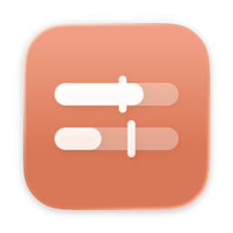
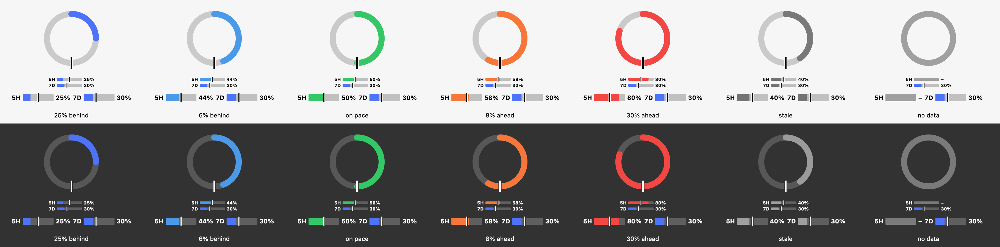

# Token Budget

A macOS menu bar widget showing how much of your Claude subscription's
**5-hour** and **7-day** limits you've used, and whether you're burning them
faster than an even pace.





> **Unofficial.** This is a personal project, not affiliated with or endorsed
> by Anthropic. It signs in with Claude Code's public OAuth client and reads an
> undocumented usage endpoint. Either can change or stop working at any time,
> and using them from a third-party app may not be permitted under Anthropic's
> terms. Check those terms before you use it. Use at your own risk.

## Reading the gauges

The menu bar shows a labelled bar for each window, **5H** and **7D**, with the
percentage used beside it. **Settings → Menu bar** switches between thin bars
stacked one above the other and full-height bars side by side. Click them to
open the panel, which shows each window as a bar with the detail.

- **Fill** (bar length) is how much of the window you've used.
- **The tick** across each bar is where you'd be if you spread usage evenly so it lands on exactly 100% at the
  reset. Fill short of it = behind, past it = ahead.
- **Colour is pace, not fullness.** The goal is to finish each window at
  exactly 100%, so **green = on pace**. **Blue = behind**: budget is going
  unused, so use more. **Amber → red = ahead**: you'll hit the limit before the
  reset, so ease off. Grey = the reading is stale (rate-limited or offline).

The panel adds the percentage, the ideal percentage, the gap in percentage
points, time to reset, and a projection ("hits 100% in 47m, 2h 10m before
reset").

## Install

```sh
scripts/install.sh
```

Builds a release bundle, compiles its icon (`Resources/AppIcon.icon`, an Icon
Composer document), signs it, copies it to
`/Applications/Token Budget.app` and launches it. Signing uses your
Apple Development (or Developer ID) certificate if you have one, which keeps
the signature stable so the Keychain only asks for access once; otherwise it
falls back to ad-hoc signing and asks after every rebuild. The app adds itself
as a login item on first run; turn that off with **Launch at login** in the panel.

On first launch the panel opens with **Sign in with Claude…**. Approve in the
browser, copy the code claude.ai shows, paste it into the panel. The token is
stored in your Keychain (service `com.domkits.claude-budget-rings`) and refreshed
automatically.

## API credits

Open **API Keys** in the panel and add a key to show that account under
**API credits**. Keys are stored in your Keychain.

| Account | Key | Shows |
|---|---|---|
| DeepSeek | API key | Balance (`GET api.deepseek.com/user/balance`) |
| Kimi | platform.kimi.ai API key | Balance (`GET api.moonshot.ai/v1/users/me/balance`) |
| OpenAI (Codex) | Organisation **admin** key (`sk-admin-…`) | This month's spend (`GET /v1/organization/costs`). OpenAI has no balance endpoint for API keys |

Balances refresh on launch, every 30 min, and when you open the panel (at
most every 5 min). A balance under $1 turns orange.

## Where the data comes from

`GET https://api.anthropic.com/api/oauth/usage` — the undocumented endpoint
behind Claude Code's `/usage`. It returns `five_hour` and `seven_day` objects
with `utilization` (0–100) and `resets_at`. Because it's undocumented it can
change without notice; the decoder ignores unknown fields and the app shows
"Anthropic changed the usage format" rather than wrong numbers.

Sign-in uses Claude Code's public OAuth client with PKCE and the manual-code
redirect, so no custom URL scheme is needed.

## Not getting rate-limited

That endpoint is throttled hard: polling every 30–60 s gets a 429 that can last
hours. The app:

1. **Only polls while Claude Code is active.** It watches `~/.claude/projects`
   for transcript writes. No writes since the last poll means utilisation
   hasn't moved (from Claude Code, at least), so it waits.
2. Polls every **5 min** (configurable 3–15) while active, with jitter.
3. Falls back to a **30-minute heartbeat** while idle, because claude.ai in a
   browser and desktop chat draw on the same limits and leave no local trace.
4. Enforces a hard floor in one place: **≥60 s between requests, ≤20 per
   hour**, whatever triggered the fetch.
5. **Refreshes the token before it expires**, never after — a request with an
   expired token is what earns the long bans.
6. On 429, honours `Retry-After`, otherwise backs off 10 → 20 → 40 → 60 min,
   and keeps showing the last reading greyed out.
7. Pauses while asleep or locked.

## The weekly window length

The endpoint states the weekly window's start in
`seven_day_breakdown.window_started_at`, and the pace line uses it directly.
If that field ever disappears, the app falls back to learning the length from
the gap between consecutive `resets_at` values (keeping the shortest seen), and
marks the weekly pace as provisional until it has seen a reset.
**Forget Learned Window Lengths** under Advanced clears what it has learned.

## Design

`UI/WidgetChrome.swift` is a vendored copy of panel code shared with the
author's other menu bar apps, kept in a separate private repo.

## Licence

MIT. See [LICENSE](LICENSE).

## Development

```sh
swift test                                   # pace maths, decoding, backoff, learning
swift run ClaudeBudgetRings --login          # sign in from the terminal
swift run ClaudeBudgetRings --probe --raw    # one live fetch, prints JSON + pace
swift run ClaudeBudgetRings --preview out.png  # render sample gauges, no network
swift run ClaudeBudgetRings --simulate-429   # run the app with every fetch 429ing
log stream --predicate 'subsystem == "com.domkits.claude-budget-rings"'
```
